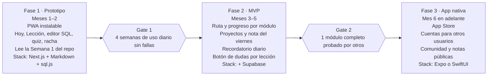

# Plan maestro: Ruta de datos y app de aprendizaje

*Creado el 21 oct 2026 · Diego Ávila*

## Visión

Una ruta para aprender datos desde cero hasta Data Engineer, entregada en una app propia para iPhone. Yo soy el usuario piloto: cada módulo se prueba conmigo, se ajusta y solo entonces se abre a otras personas.

- **Para quién:** cualquier persona que empieza desde cero, o un analista que quiere dar el salto.
- **Compromiso:** 1 hora diaria, lunes a viernes (5 h/semana).
- **Promesa:** lecciones tan claras que no necesitas a nadie al lado para entenderlas.
- **Principio de construcción:** primero el contenido, después la app. La app solo muestra lo que el contenido ya resolvió.

## Modelo de aprendizaje híbrido

*Actualizado el 27 oct 2026: la ruta ya no va por días de la semana, sino por unidades con paradas.*

Cada módulo se divide en **unidades** (antes "semanas"). Cada unidad es un camino de **paradas** que se abren en orden; al terminar una se abre la siguiente. En la app se ve como un mapa.

| Parada | Qué se hace | Qué se entrega |
| --- | --- | --- |
| Lección 1 | Concepto nuevo, contado como historia | Quiz corto de comprensión |
| Lección 2 | Profundización + ejemplo resuelto | Ejercicios guiados |
| Proyecto 1 | Mini-proyecto: arranque | Datos explorados y plan del análisis |
| Proyecto 2 | Mini-proyecto: cierre | Consulta, script o notebook terminado |
| Repaso | Repaso + nota pública | Publicación en LinkedIn, blog o GitHub |

**Reglas del ciclo**

- Ritmo sugerido: una parada por día (1 h), lunes a viernes. Se pueden hacer varias en un día; la racha cuenta si haces al menos una.
- No se salta una parada: la ruta mide avance por temas, no por fechas.
- La nota del repaso sigue una plantilla fija: qué aprendí, un ejemplo propio, un error que cometí.
- Cada 4 unidades, una parada extra de repaso espaciado de los temas anteriores.
- Cada módulo cierra con un **proyecto integrador** para portafolio y, en los módulos clave, un **examen de salida**.

## Ruta completa

*Aprobado el 29 oct 2026. La revisión completa (por qué cambió cada cosa), la historia de toda la ruta y las herramientas propuestas están en `docs/plan-de-contenido.md`.*

Cuatro etapas y 20 módulos, unas 90 unidades (una unidad = 5 paradas, una por día a 1 h diaria). Las duraciones se ajustan con la prueba piloto.

| Etapa | Módulo | Unidades | Proyecto integrador |
| --- | --- | --- | --- |
| 0 · Fundamentos | M1. Pensar con datos (sin Excel: datos, tablas, preguntas de negocio, qué es una base de datos) | 3 | Convertir la libreta de Don Rafa en tablas y preguntas |
| 0 · Fundamentos | M2. SQL desde cero | 8 | Reporte de clientes de Abarrotes La Esquina |
| 0 · Fundamentos | M3. SQL para análisis | 7 | Examen de salida: un mes completo de La Esquina |
| 0 · Fundamentos | M4. Python desde cero (puente desde SQL) | 6 | Resumen semanal automático de un CSV |
| 0 · Fundamentos | M5. Git y GitHub (con simulador en la app) | 2 | Repositorio de portafolio |
| 1 · Data Analyst | M6. Estadística descriptiva | 4 | Perfil estadístico de las ventas |
| 1 · Data Analyst | M7. Visualización | 3 | Gráficas para la junta de Mariana |
| 1 · Data Analyst | M8. Métricas, KPIs, dashboards y storytelling | 4 | Dashboard con recomendación |
| 2 · Data Scientist | M9. Probabilidad | 4 | Simulador de escenarios de ventas |
| 2 · Data Scientist | M10. Inferencia y pruebas A/B | 5 | Evaluación de la promoción de Lupita |
| 2 · Data Scientist | M11. Matemáticas para ML (lo esencial) | 4 | Regresión lineal programada a mano |
| 2 · Data Scientist | M12. pandas avanzado y feature engineering | 4 | Dataset de clientes listo para modelar |
| 2 · Data Scientist | M13. Machine learning supervisado | 6 | Modelo de churn contra MegaMart |
| 2 · Data Scientist | M14. No supervisado y series de tiempo | 5 | Segmentos de clientes y pronóstico de demanda |
| 2 · Data Scientist | M15. IA aplicada a datos (LLMs) | 3 | Clasificador de comentarios de clientes |
| 3 · Data Engineer | M16. Modelado de datos | 4 | Modelo en estrella de 20 sucursales |
| 3 · Data Engineer | M17. Terminal y Docker (terminal simulada) | 2 | Proyecto empaquetado en un contenedor |
| 3 · Data Engineer | M18. Pipelines ETL/ELT (dbt y Airflow) | 6 | Pipeline nocturno automatizado |
| 3 · Data Engineer | M19. Cloud y almacenamiento | 5 | Pipeline desplegado en la nube |
| 3 · Data Engineer | M20. Calidad, monitoreo y proyecto final | 5 | La plataforma de datos de La Esquina, de punta a punta |

**Entrada por nivel:** quien ya trabaja con SQL, Power BI y Python hace la Etapa 0 en modo repaso (diagnóstico por módulo; si lo aprueba, pasa directo al integrador).

**Lo que no se practica en el iPhone** (Excel, Git, terminal, Docker, Airflow, nube) se cubre con simuladores dentro de la app y un proyecto opcional "en tu computadora".

### SQL a fondo antes de Python

SQL es la base de todo lo demás, así que se cubre completo antes de pasar a Python. Todo SQL avanzado (CTE, funciones de ventana) vive aquí y no en la etapa de Engineering, porque es lo que más usa un Data Analyst en el trabajo diario.

**M2 · SQL desde cero**

1. Tu primera consulta: SELECT, FROM, WHERE *(hecha)*
2. Ordenar y elegir: ORDER BY, ASC/DESC, LIMIT, DISTINCT
3. Filtros combinados: AND, OR, NOT, paréntesis, IN, BETWEEN, LIKE, IS NULL
4. Columnas calculadas: alias, operaciones, ROUND, CASE WHEN, NULL y COALESCE
5. Resumir: COUNT, SUM, AVG, MIN, MAX, GROUP BY, HAVING
6. Fechas y texto: mes, día de la semana, diferencia de días, UPPER, TRIM, REPLACE, SUBSTR, CAST
7. Unir tablas: llaves, INNER JOIN, LEFT JOIN y duplicados por un JOIN mal hecho
8. Proyecto integrador: reporte de clientes de Abarrotes La Esquina

**M3 · SQL para análisis**

1. JOIN a fondo y subconsultas
2. CTE (`WITH`): consultas largas, por pasos y legibles
3. Funciones de ventana I: ROW_NUMBER, RANK, top N por grupo
4. Funciones de ventana II: LAG/LEAD, acumulados, promedio móvil, % del total
5. Patrones de negocio: embudo, cohortes, retención, clientes recurrentes
6. Crear y cuidar datos: CREATE TABLE, INSERT, UPDATE, DELETE, vistas, UNION, duplicados, índices
7. Examen de salida: varias tablas, CTE y ventanas, explicado en palabras de negocio. Aprobarlo abre Python

**Dataset:** Abarrotes La Esquina crece con la historia: 8 ventas en la Unidad 1, un trimestre (octubre a diciembre de 2026) desde la Unidad 2, tablas de clientes, productos y sucursales desde la Unidad 7, y 12 meses con pedidos en línea en M3. SQLite (sql.js) soporta funciones de ventana.

**Puente a Python (M4):** primero lo básico del lenguaje (variables, listas, diccionarios, ciclos, funciones) con los mismos datos de Don Rafa. Después pandas se enseña como traducción de lo que ya sabes: filtrar = WHERE, `groupby` = GROUP BY, `merge` = JOIN.

## Estándar pedagógico de las lecciones

Toda lección sigue la misma estructura y pasa el mismo checklist antes de publicarse. Este estándar vive en la skill `docente-datos` (`skills/docente-datos/SKILL.md`), que se usa para escribir y revisar cada lección.

**Estructura de una lección (30 min de lectura y práctica)**

1. **Objetivo:** "Al terminar podrás…" con un verbo medible (calcular, escribir, interpretar).
2. **Por qué importa:** una situación real de trabajo donde se usa.
3. **Lo que ya sabes:** conecta con un tema anterior o con la vida diaria.
4. **La idea en una frase:** el concepto sin jerga.
5. **Analogía:** una imagen cotidiana que lo haga intuitivo.
6. **Explicación por capas:** de lo simple a lo formal; la fórmula o el código al final, no al inicio.
7. **Ejemplo resuelto:** paso a paso, con datos realistas y cada paso comentado.
8. **Errores comunes:** 2–3 confusiones típicas y cómo detectarlas.
9. **Práctica guiada:** ejercicios con pistas graduales.
10. **Revisa tu comprensión:** 3–5 preguntas con retroalimentación que explica el porqué.
11. **Resumen:** 3 ideas clave para llevar.

**Reglas de claridad**

- Una idea por párrafo; frases de menos de 25 palabras.
- Todo término técnico se define la primera vez que aparece.
- Nada se da por sabido si no está en un módulo anterior.
- Ejemplos con contextos reconocibles: tiendas, ventas, clientes, transporte.
- Pensado para leerse en el celular: bloques cortos, código de pocas líneas.

**Checklist de calidad (antes de publicar)**

- [ ] ¿Alguien sin experiencia entiende la idea en una frase?
- [ ] ¿El ejemplo resuelto se puede reproducir paso a paso?
- [ ] ¿Cada ejercicio practica exactamente el objetivo de la lección?
- [ ] ¿La retroalimentación explica el error, no solo la respuesta correcta?
- [ ] ¿Lo probé yo (piloto) y anoté qué no quedó claro?

## Arquitectura de contenido

El contenido vive separado de la app, en el repositorio (carpeta `contenido/`). Así una lección se corrige sin volver a publicar la app.

**Cada lección lleva un encabezado (frontmatter) que la app lee:** id, módulo, semana, día, objetivo, duración, prerequisitos, dataset y versión.

**Práctica integrada:** el editor de la app carga automáticamente el dataset del módulo (`datasets/*.sql`) y ejecuta las consultas en el propio dispositivo. No se usan páginas externas.

**Ciclo de prueba y ajuste**

1. Se escribe la lección con la skill de docente.
2. La estudio como piloto y anoto dudas en la app (botón "no me quedó claro").
3. Se corrige y sube la versión (v1.0 → v1.1).
4. El módulo se marca "listo para otros" cuando pasa el checklist y la prueba piloto.

## Camino a la app en 3 fases

La app crece en tres fases y solo se pasa a la siguiente cuando la anterior se validó en uso real. La Fase 1 empieza en cuanto exista la primera semana de contenido (ya existe).

Los meses son estimados. Next.js y Supabase son sugerencias para empezar rápido; la elección entre Expo y SwiftUI queda en las decisiones pendientes.

## Flujo del usuario en la app

La app abre en la **Ruta**: un mapa con la parada que te toca, sin tener que decidir qué estudiar.

**Primera vez**

1. Bienvenida: elegir meta (Analyst, Scientist o Engineer) y horario de estudio.
2. Diagnóstico corto para decidir desde qué módulo empezar.
3. Activar recordatorio diario.

**Recorrido diario**

1. Notificación a la hora elegida.
2. **Ruta**: la parada que te toca, con su tema y tiempo estimado.
3. Lección, mini-proyecto o repaso con nota, según la parada.
4. Quiz o entregable del día.
5. Marcar como completado: suma racha y avance del módulo.

**Pantallas principales**

| Pantalla | Para qué sirve |
| --- | --- |
| Ruta | Mapa de la unidad con sus paradas; arriba "sigue donde te quedaste" |
| Lección | Lectura por bloques, editor de código integrado y quiz |
| Proyecto | Instrucciones, dataset precargado y entrega |
| Notas | Editor de la nota del repaso con plantilla y botón para compartir |
| Práctica *(propuesta)* | Terminal libre con los datasets y repaso de tus errores y temas pasados |
| Chuleta *(propuesta)* | Todo lo que has desbloqueado (comandos y ejemplos), para consultar rápido |
| Tú | Avatar, clóset, racha, logros y ajustes |

La barra inferior está por definir; la propuesta es **Ruta · Práctica · Chuleta · Tú**, y Portafolio cuando haya proyectos que mostrar.

## Próximos pasos

- [x] Guardar la skill de docente y ajustarla con una lección de prueba
- [x] Escribir la Semana 1 del M2 (SQL) completa como lección muestra
- [x] Crear el repositorio de contenido con la estructura propuesta
- [x] Diseñar el mapa de la Ruta (maqueta en `docs/maquetas/ruta-mapa.html`)
- [ ] Definir la barra inferior (propuesta: Ruta · Práctica · Chuleta · Tú)
- [x] Construir el prototipo PWA que lea la Semana 1, con editor SQL integrado (sql.js)
- [ ] Publicar la PWA y usarla a diario (Gate 1); camino a App Store en `docs/camino-app-store.md`
