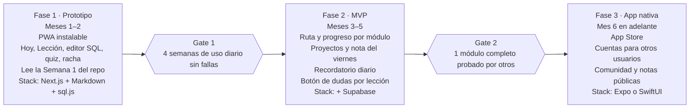

# Plan maestro: Ruta de datos y app de aprendizaje

*Creado el 21 oct 2026 · Diego Ávila*

## Visión

Una ruta para aprender datos desde cero hasta Data Engineer, entregada en una app propia para iPhone. Yo soy el usuario piloto: cada módulo se prueba conmigo, se ajusta y solo entonces se abre a otras personas.

- **Para quién:** cualquier persona que empieza desde cero, o un analista que quiere dar el salto.
- **Compromiso:** 1 hora diaria, lunes a viernes (5 h/semana).
- **Promesa:** lecciones tan claras que no necesitas a nadie al lado para entenderlas.
- **Principio de construcción:** primero el contenido, después la app. La app solo muestra lo que el contenido ya resolvió.

## Modelo de aprendizaje híbrido

Cada semana cubre un tema y termina con un mini-proyecto y una nota pública. Cada módulo (4–6 semanas) cierra con un proyecto integrador para portafolio.

| Día | Bloque (1 h) | Qué se entrega |
| --- | --- | --- |
| Lunes | Lección: concepto nuevo | Quiz corto de comprensión |
| Martes | Lección: profundización + ejemplo resuelto | Ejercicios guiados |
| Miércoles | Mini-proyecto: arranque | Datos cargados y plan del análisis |
| Jueves | Mini-proyecto: cierre | Notebook o query terminada |
| Viernes | Repaso + nota pública | Publicación en LinkedIn, blog o GitHub |

**Reglas del ciclo**

- Si una semana se atrasa, se recorre; no se salta. La ruta mide avance por temas, no por fechas.
- La nota del viernes sigue una plantilla fija: qué aprendí, un ejemplo propio, un error que cometí.
- Cada 4 semanas, una sesión de repaso espaciado de los temas anteriores.

## Ruta completa

Tres etapas y 15 módulos, unas 70 semanas a 5 h/semana. Las duraciones son estimadas y se ajustan con la prueba piloto.

| Etapa | Módulo | Semanas | Proyecto integrador |
| --- | --- | --- | --- |
| 0 · Fundamentos | M1. Pensar con datos: tipos de datos, preguntas de negocio, Excel | 4 | Análisis de ventas de una tienda en Excel |
| 0 · Fundamentos | M2. SQL desde cero | 5 | Reporte de clientes con consultas propias |
| 0 · Fundamentos | M3. Python desde cero | 5 | Script que limpia y resume un CSV |
| 0 · Fundamentos | M4. Estadística descriptiva y visualización | 4 | Dashboard explicativo de un dataset público |
| 1 · Data Science | M5. Probabilidad | 4 | Simulador de escenarios de ventas |
| 1 · Data Science | M6. Inferencia y pruebas A/B | 5 | Evaluación de una campaña con prueba A/B |
| 1 · Data Science | M7. Álgebra lineal y cálculo para ML (lo esencial) | 4 | Regresión lineal programada a mano |
| 1 · Data Science | M8. pandas avanzado y feature engineering | 4 | Dataset listo para modelar |
| 1 · Data Science | M9. Machine learning supervisado | 6 | Modelo de churn con evaluación completa |
| 1 · Data Science | M10. No supervisado y series de tiempo | 5 | Segmentación de clientes + pronóstico de demanda |
| 2 · Data Engineering | M11. Modelado de datos y SQL avanzado | 5 | Modelo dimensional (estrella) de ventas |
| 2 · Data Engineering | M12. Git, terminal y Docker | 3 | Proyecto empaquetado y versionado |
| 2 · Data Engineering | M13. Pipelines ETL/ELT con dbt y Airflow | 6 | Pipeline diario automatizado |
| 2 · Data Engineering | M14. Cloud y almacenamiento (data lake, warehouse) | 5 | Pipeline desplegado en la nube |
| 2 · Data Engineering | M15. Calidad, monitoreo y proyecto final | 5 | Plataforma de datos end-to-end |

**Entrada por nivel:** quien ya trabaja con SQL, Power BI y Python hace la Etapa 0 en modo repaso (examen diagnóstico por módulo; si lo aprueba, pasa directo al integrador).

## Estándar pedagógico de las lecciones

Toda lección sigue la misma estructura y pasa el mismo checklist antes de publicarse. Este estándar vive en la skill `docente-datos` (`skills/docente-datos/SKILL.md`), que se usa para escribir y revisar cada lección.

**Estructura de una lección (30 min de lectura y práctica)**

1. **Objetivo:** "Al terminar podrás…" con un verbo medible (calcular, escribir, interpretar).
2. **Por qué importa:** una situación real de trabajo donde se usa.
3. **Lo que ya sabes:** conecta con un tema anterior o con la vida diaria.
4. **La idea en una frase:** el concepto sin jerga.
5. **Analogía:** una imagen cotidiana que lo haga intuitivo.
6. **Explicación por capas:** de lo simple a lo formal; la fórmula o el código al final, no al inicio.
7. **Ejemplo resuelto:** paso a paso, con datos realistas y cada paso comentado.
8. **Errores comunes:** 2–3 confusiones típicas y cómo detectarlas.
9. **Práctica guiada:** ejercicios con pistas graduales.
10. **Revisa tu comprensión:** 3–5 preguntas con retroalimentación que explica el porqué.
11. **Resumen:** 3 ideas clave para llevar.

**Reglas de claridad**

- Una idea por párrafo; frases de menos de 25 palabras.
- Todo término técnico se define la primera vez que aparece.
- Nada se da por sabido si no está en un módulo anterior.
- Ejemplos con contextos reconocibles: tiendas, ventas, clientes, transporte.
- Pensado para leerse en el celular: bloques cortos, código de pocas líneas.

**Checklist de calidad (antes de publicar)**

- [ ] ¿Alguien sin experiencia entiende la idea en una frase?
- [ ] ¿El ejemplo resuelto se puede reproducir paso a paso?
- [ ] ¿Cada ejercicio practica exactamente el objetivo de la lección?
- [ ] ¿La retroalimentación explica el error, no solo la respuesta correcta?
- [ ] ¿Lo probé yo (piloto) y anoté qué no quedó claro?

## Arquitectura de contenido

El contenido vive separado de la app, en el repositorio (carpeta `contenido/`). Así una lección se corrige sin volver a publicar la app.

**Cada lección lleva un encabezado (frontmatter) que la app lee:** id, módulo, semana, día, objetivo, duración, prerequisitos, dataset y versión.

**Práctica integrada:** el editor de la app carga automáticamente el dataset del módulo (`datasets/*.sql`) y ejecuta las consultas en el propio dispositivo. No se usan páginas externas.

**Ciclo de prueba y ajuste**

1. Se escribe la lección con la skill de docente.
2. La estudio como piloto y anoto dudas en la app (botón "no me quedó claro").
3. Se corrige y sube la versión (v1.0 → v1.1).
4. El módulo se marca "listo para otros" cuando pasa el checklist y la prueba piloto.

## Camino a la app en 3 fases

La app crece en tres fases y solo se pasa a la siguiente cuando la anterior se validó en uso real. La Fase 1 empieza en cuanto exista la primera semana de contenido (ya existe).

Los meses son estimados. Next.js y Supabase son sugerencias para empezar rápido; la elección entre Expo y SwiftUI queda en las decisiones pendientes.

## Flujo del usuario en la app

La app abre siempre en "Hoy": una sola tarea de 1 hora, sin tener que decidir qué estudiar.

**Primera vez**

1. Bienvenida: elegir meta (Analyst, Scientist o Engineer) y horario de estudio.
2. Diagnóstico corto para decidir desde qué módulo empezar.
3. Activar recordatorio diario.

**Recorrido diario**

1. Notificación a la hora elegida.
2. Pantalla **Hoy**: tema, objetivo y tiempo estimado.
3. Lección (lunes–martes), mini-proyecto (miércoles–jueves) o nota (viernes).
4. Quiz o entregable del día.
5. Marcar como completado: suma racha y avance del módulo.

**Pantallas principales**

| Pantalla | Para qué sirve |
| --- | --- |
| Hoy | La tarea del día, en un toque |
| Ruta | Mapa de etapas y módulos con avance |
| Lección | Lectura por bloques, editor de código integrado y quiz |
| Proyecto | Instrucciones, dataset precargado y entrega |
| Notas | Editor de la nota del viernes con plantilla y botón para compartir |
| Progreso | Racha, horas acumuladas, módulos y proyectos terminados |

## Próximos pasos

- [x] Guardar la skill de docente y ajustarla con una lección de prueba
- [x] Escribir la Semana 1 del M2 (SQL) completa como lección muestra
- [x] Crear el repositorio de contenido con la estructura propuesta
- [ ] Diseñar las pantallas Hoy, Lección y Ruta (mockups)
- [x] Construir el prototipo PWA que lea la Semana 1, con editor SQL integrado (sql.js)
- [ ] Publicar la PWA y usarla a diario (Gate 1); camino a App Store en `docs/camino-app-store.md`
